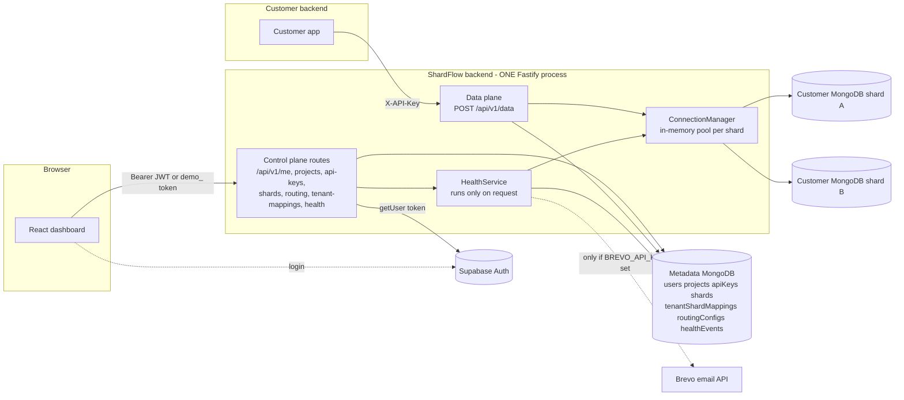
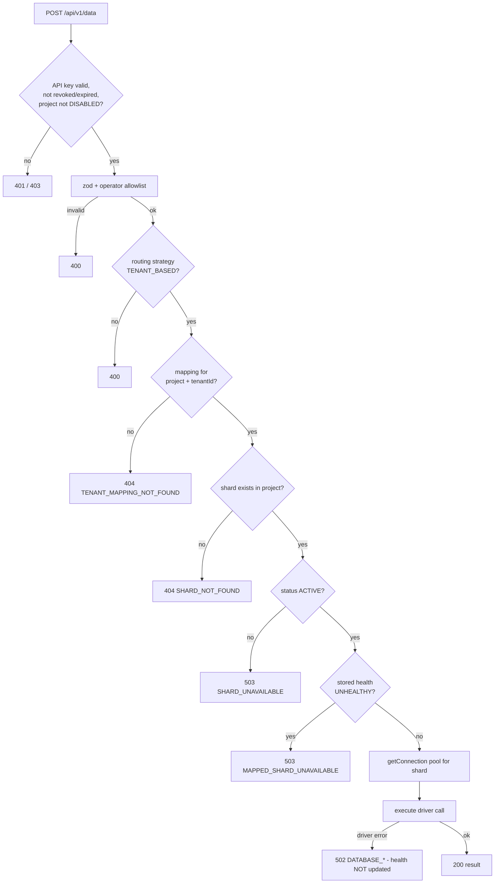
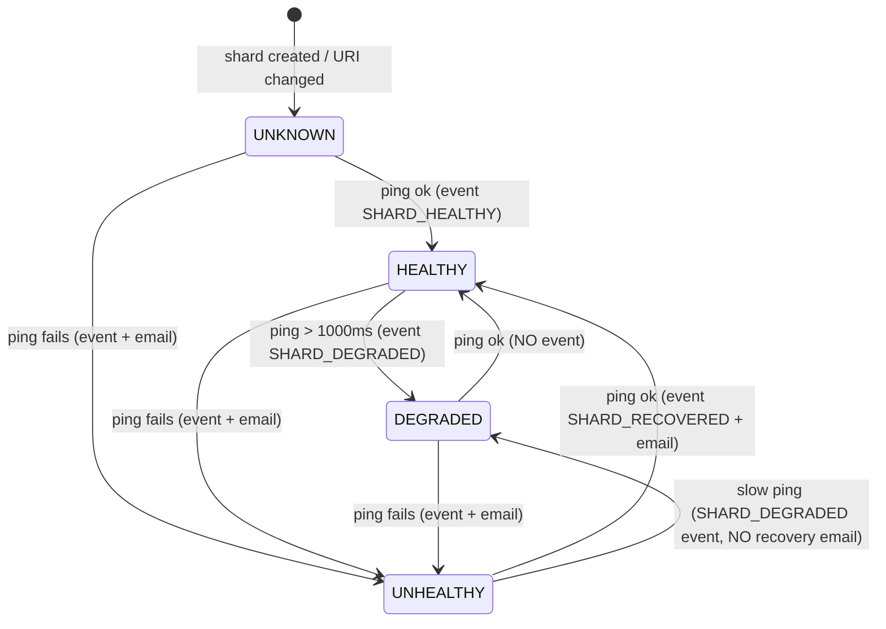

# ShardFlow V1 — Technical Investigation & Audit

**Document:** Evidence-based technical audit of the ShardFlow V1 repository
**Audit date:** 2026-10-17
**Scope:** `D:\shardflow` (backend, frontend, docs, deploy config) at git commit `3eb1795` (branch `development`, clean working tree at audit end)
**Method:** static source inspection, doc-vs-code comparison, read-only test execution, and small read-only runtime probes against real repo code (no network, no database, no secrets)
**Status of repo during audit:** unmodified. This file is the only file added.

---

## 0. How to read this document

Every statement is tagged by evidence class:

| Tag | Meaning |
|---|---|
| **[V]** Verified | Directly supported by source code, a passing test, or a runtime probe I executed |
| **[D]** Documented | Stated in `docs/*` but not necessarily implemented |
| **[I]** Inference | Reasoned from code; needs confirmation |
| **[U]** Unverified / Missing | Could not be established from available evidence |

Severity: Critical / High / Medium / Low / Informational. Confidence: High / Medium / Low.

### 0.1 Limits of this audit (read first)

- **No live environment.** I had no running ShardFlow deployment, no metadata MongoDB, no customer shard, no Supabase project, no Brevo account. Anything about real-world runtime behavior is static reasoning unless marked as a probe (Appendix B).
- **Secrets.** `backend/.env` and `frontend/.env` exist on disk. I did **not** open them. Only the `.env.example` files were read, with values redacted. This document contains no secret values.
- **Tests run:** `vitest run` in `backend/` with Mongo/Supabase env vars unset → **20 files, 162 tests, all passed**; `tsc --noEmit` → clean. The frontend has no test tooling.
- **Dependency audit:** `npm audit` (read-only registry query) was run for both packages; only counts and package names were examined (section 15.4).
- **Not exhaustively read:** `docs/research.md`, `docs/memory.md`, `docs/error-codes.md`, `docs/rules.md`, and `frontend/docs/*` were read only by headings and targeted passages. The JSX bodies of the landing-page sections and UI primitives (`components/ui/*`) were not read. Dashboard pages were read for data flow, handlers and loading/empty/error branches (not pixel-level rendering).

---

## 1. Executive summary

ShardFlow V1 is a **single Node/Fastify service** plus a **React dashboard**. It stores its own metadata (users, projects, API keys, shards, tenant→shard mappings, routing config, health events) in a MongoDB database. It also acts as a **query proxy** to customers' MongoDB databases ("shards"): a customer's backend sends one of five allowlisted operations to `POST /api/v1/data` with an API key; ShardFlow finds the shard mapped to the request's `tenantId` and executes the operation there using the official `mongodb` driver. Dashboard login uses Supabase Auth.

### The ten facts that matter most

1. **Routing is a table lookup, not an algorithm.** `tenantId → shardId` is a stored row (`tenantShardMappings`). No hashing, ranges, round-robin, capacity logic or auto-placement exists. A tenant with no row gets HTTP 404. **[V]** `routing-engine.ts:37-88`
2. **Mapping changes move no data.** Remapping a tenant changes one field; the tenant's existing documents stay on the old shard and become invisible. There is no resharding, versioning or migration. **[V]** `routing.service.ts:115-138`
3. **Health monitoring is on-demand only.** The documented "Health Monitor Worker" does not exist. Shard checks run only when someone calls `GET /projects/:id/health` (the dashboard Health page polls it every 30 s) or when a shard is registered/edited. **[V]**
4. **The router consults stored health, not live health.** `UNHEALTHY` is blocked; `UNKNOWN` and `DEGRADED` are routed. Failed data-plane calls never update health. **[V]** `routing-engine.ts:80`
5. **Authentication has a built-in bypass.** The backend accepts any bearer token starting with `demo_` without contacting Supabase, and the sign-in/sign-up pages log the user in as a "demo user" on **any** Supabase error (including a wrong password). **[V, runtime-probed at service level]**
6. **No tenant isolation inside a shard.** `tenantId` selects the shard and is then discarded. A `find` with filter `{}` or a `delete-one` with filter `{}` reaches Mongo unchanged. **[V, probed]**
7. **Control-plane indexes are never created at runtime.** `initControlPlaneIndexes()` is called only from a test. Documented uniqueness (tenant mapping, shard name, API-key hash, user id) is enforced only by check-then-insert in services. **[V]**
8. **Several dashboard features do not match the backend:** disable-shard (400), update-mapping (404), delete-mapping (500), health detail fields, activity feed (fabricated fallback data), notification popover (hard-coded data). **[V]**
9. **Security hardening is absent:** no rate limiting, `CORS: *`, no security headers, unused body-size constant, driver error text echoed to clients. `docs/task.md` lists Phase 8 (security/testing) and Phase 9 (deployment) as *Planned*. **[V]**
10. **Backend code quality is solid for its scope:** clean layering, consistent error envelope, allowlist-based operator validation, AES-256-GCM for stored shard URIs, SHA-256 hashed API keys with 192-bit entropy, and 162 passing unit tests. Tests use in-memory fakes, so they prove logic, not integration.

### Overall assessment

The **data-plane core and control-plane CRUD are well-built and internally consistent** for a V1. The **operational layer (monitoring, failure handling, security hardening) is largely not built**, and the **frontend has several broken or fabricated paths** that make the product look more complete than it is. The single most important decision before any non-local deployment is the `demo_` authentication path (D1).

---

## 2. Verified technology stack

| Area | Technology | Where used / role | Status |
|---|---|---|---|
| Language (backend) | TypeScript, `strict`, `noUncheckedIndexedAccess`, target ES2022, `module: NodeNext` | `backend/tsconfig.json` | [V] |
| Runtime | Node.js ESM (`"type":"module"`); tested here on Node 22.19 | `backend/package.json` | [V] |
| Backend framework | Fastify ^5 | `app.ts`, all `*.routes.ts` | [V] |
| Validation | zod ^4 | request bodies (`validateRequest`), data-plane schemas, models | [V] |
| Metadata store | MongoDB via `mongodb` driver ^7 | `database/client.ts`, all repositories | [V] |
| Customer databases | **MongoDB only** (driver per shard) | `connection-manager`, `database-executor` | [V] |
| Auth (dashboard) | Supabase Auth (`getUser(token)` per request) + JIT local user | `auth/*` | [V] |
| Auth (data plane) | `X-API-Key`, SHA-256 hash lookup | `data-plane-auth.middleware.ts` | [V] |
| Crypto | `node:crypto`: SHA-256, AES-256-GCM, `randomBytes` | `api-key.model.ts`, `shard.model.ts` | [V] |
| Logging | Fastify's pino with redaction paths | `observability/logger.ts` | [V] |
| Email | Brevo REST (`fetch`), mock-success when no key | `health/notification.service.ts` | [V] (silent without `BREVO_API_KEY`) |
| Tests | vitest ^5 (backend only) | 20 files / 162 tests | [V] |
| Frontend | React 18, react-router 6, TanStack Query 5, Tailwind 3, Vite 6, lucide-react | `frontend/src` | [V] |
| Frontend auth | `@supabase/supabase-js` + localStorage demo user | `AuthProvider`, `lib/api/client.ts` | [V] |
| Deploy | Render blueprint (backend, free plan); Vercel SPA rewrite (frontend) | `render.yaml`, `frontend/vercel.json` | [V] config only |
| **Not present** | Queue, cache, scheduler/cron/worker, rate limiter, CORS/helmet plugins, Docker, CI/CD, SDK, migrations, seed scripts | repo-wide grep | [V] absent |

Manifest notes: `typescript` and `@types/node` are in backend `dependencies` (not dev); harmless on Render because the build runs `tsc`. `MAX_REQUEST_BODY_BYTES` is defined but never used.

---

## 3. Repository tree (tracked files, build output and secrets excluded)

```
shardflow/
├─ readme.md                    product overview (503 lines)
├─ render.yaml                  Render blueprint (backend only)
├─ docs/
│  ├─ api.md                    API contract (1637 lines)      error-contract.md   error envelope + status map
│  ├─ architecture.md           (2093)                         error-codes.md      error code catalog
│  ├─ database_design.md        (1766)                         memory.md / research.md / rules.md
│  ├─ prd.md                    (2239)                         phases.md / task.md  roadmap + tracker
│  └─ shardflow_info.md         ← this audit
├─ backend/
│  ├─ package.json, tsconfig.json, vitest.config.ts, .env.example, README.md
│  └─ src/
│     ├─ server.ts              process entry: config → buildApp → DB connect → listen
│     ├─ app.ts                 Fastify construction, hooks, route registration
│     ├─ config/                loadConfig() (+test)
│     ├─ database/              metadata MongoClient singleton (+test)
│     ├─ connection-manager/    per-shard MongoClient pools
│     ├─ auth/                  middleware, service, supabase client, auth-flow-testing/*.js (manual scripts)
│     ├─ control-plane/
│     │   ├─ models/            user, project, api-key, shard, routing-config, tenant-mapping, health-event
│     │   ├─ repositories/      one per model (+ big repositories.test.ts)
│     │   ├─ services/          project, api-key, shard, routing
│     │   ├─ controllers/       user, project, api-key, shard, routing, tenant-mapping
│     │   └─ routes/            me, project, api-key, shard, routing, tenant-mapping (+tests)
│     ├─ data-plane/
│     │   ├─ routes/ controllers/ middleware/ models/
│     │   └─ services/          data-plane, request-validator, routing-engine, database-executor
│     ├─ health/                health-check, health.service, notification.service, controller, routes
│     ├─ errors/                AppError hierarchy, codes, central handler
│     ├─ validation/            zod → BadRequestError, validateRequest preHandler
│     └─ observability/         logger options + redaction
└─ frontend/
   ├─ package.json, vite/tailwind/tsconfig, index.html, vercel.json, .env.example, docs/
   └─ src/
      ├─ main.tsx               providers → AppRouter
      ├─ app/                   config/env.ts, providers/{Query,Auth,Project}, router/index.tsx
      ├─ app.router/index.tsx   DEAD duplicate router (not imported by anything)
      ├─ components/            ui/*, feedback/*, layout/DashboardLayout, navigation/*
      ├─ features/              activity, api-keys, auth, health, integration, landing, projects, routing, settings, shards
      ├─ lib/                   api/client.ts, supabase/client.ts, utils/cn.ts
      └─ types/index.ts
```

Totals: 228 tracked files, 31 commits at audit start (32 at end: `3eb1795` was committed by the user mid-audit and contains the three previously uncommitted frontend files).

---

## 4. File-by-file responsibility map (significant files)

Status: **C** complete · **P** partial · **U** unused · **M** mocked/placeholder behavior

### 4.1 Backend entry & infrastructure

| File | Responsibility / key exports | Invoked by | Status |
|---|---|---|---|
| `backend/src/server.ts` | `start()`: `loadConfig` → `buildApp` → SIGINT/SIGTERM handlers → `connectDatabase` → `app.listen` | `npm start` / `tsx watch` | C |
| `app.ts` | `buildApp(config, deps)`: logger, error/404 handlers, CORS `onRequest` hook (l.80-88), `onClose` DB close (l.90), `GET /health` (l.95), constructs services/controllers, registers all routes (l.141-153) | `server.ts`, tests | C (no scheduler) |
| `config/index.ts` | `loadConfig()`; requires `MONGODB_URI`, `SUPABASE_URL`, `SUPABASE_ANON_KEY`; test mode substitutes dummy Supabase values (l.28, 33) | `server.ts` | C |
| `database/client.ts` | Singleton metadata `MongoClient` (default options, no explicit timeouts), `getDatabase`, `closeDatabase`, `isDatabaseConnected` | repos, server | C |
| `connection-manager/index.ts` | `ConnectionManager`: lazy pool per shard (`maxPoolSize 10`, connect 10 s, socket 30 s, server-select 10 s), `getConnection`, `ping`, `closeConnection`, `closeAll`; singleton `connectionManager` | executor, health, shard service | P (race, no eviction; `closeAll` never called on shutdown) |
| `errors/*` | `AppError` subclasses → HTTP status; `ErrorCode` catalog; `errorHandler`, `notFoundHandler` | Fastify | C |
| `validation/index.ts` | `validateData`, `formatZodError`, `validateRequest` (replaces `request.body` with the **parsed/stripped** result) | route preHandlers | C |
| `observability/logger.ts` | pino options; redacts auth/x-api-key headers and `*.password/key/apiKey/keyHash/token/connectionUri/mongodbUri/secret`; silent in test | `app.ts` | C |

### 4.2 Auth

| File | Responsibility | Status |
|---|---|---|
| `auth/auth.middleware.ts` | `createAuthMiddleware(authService)` → parses `Bearer`, calls service, sets `request.user`/`supabaseUser` | C |
| `auth/auth.service.ts` | `authenticateAndSyncUser`: **`demo_` branch (l.32-50)** or Supabase `getUser`; JIT-create user; reject `DISABLED` | C, **D1** |
| `auth/supabase.client.ts` | `createSupabaseClient` (no session persistence), `verifySupabaseToken` (maps expired/invalid/unavailable) | C |
| `auth/auth-flow-testing/*.js` | Five manual Node scripts (create user, call `/me`, project/API-key flows) that hit a locally running server using Supabase credentials from env. Read, **not run**. | Manual tooling |

### 4.3 Control plane

| File(s) | Responsibility | Status |
|---|---|---|
| `models/*.model.ts` | Interfaces, enums, zod schemas; `shard.model.ts` also holds **AES-256-GCM encrypt/decrypt**; `api-key.model.ts` holds key generation/hash/active check | C |
| `repositories/*.repository.ts` | Mongo access + `ensureIndexes()` per collection | C (indexes not invoked, D2) |
| `services/project.service.ts` | Owner-scoped CRUD, unique `(ownerId,name)` check-then-insert, soft disable | C |
| `services/api-key.service.ts` | Create (raw key returned once), list, revoke; rejects creation on disabled project | C |
| `services/shard.service.ts` | Register (encrypt → insert → ping → set health), list/get/update (URI change closes pool, re-pings), disable (closes pool) | C |
| `services/routing.service.ts` | Mapping CRUD + routing-config get/update (only `TENANT_BASED`) | C |
| `controllers/*` | Param checks, response shaping (`formatShard` omits `encryptedConnectionUri`) | C (routing/mapping controllers don't validate ObjectId format, D16) |
| `routes/*.routes.ts` | Register URLs with `requireAuth` (+ `validateRequest` on some bodies) | C |
| `control-plane/index.ts` | Barrel + `initControlPlaneIndexes()` (**never called outside tests**) | P |

### 4.4 Data plane

| File | Responsibility | Status |
|---|---|---|
| `data-plane.routes.ts` | `POST /api/v1/data` with `dataPlaneAuthMiddleware` | C |
| `data-plane-auth.middleware.ts` | `X-API-Key` → `hashApiKey` → `findByKeyHash` → revoked/expired/project-disabled checks → fire-and-forget `updateLastUsed` → `request.dataPlaneContext` | C |
| `data-plane.controller.ts` / `data-plane.service.ts` | Orchestrate validate → route → execute; success message by operation | C |
| `request-validator.ts` | `parseAndValidateDataRequest`, recursive `validateFilterOperators` (depth ≤10), `validateUpdateOperators` | C |
| `data-request.model.ts` | zod schemas, operator allowlists, `MAX_FIND_LIMIT=100`, collection regex, **unused** `MAX_REQUEST_BODY_BYTES` | C |
| `routing-engine.ts` | `resolveShard` (section 10) | C |
| `database-executor.ts` | Executes the 5 operations; maps driver errors to `AppError`s; `normalizeFilter` converts 24-hex `_id` to `ObjectId` | C (no tenant scoping, no `maxTimeMS`) |

### 4.5 Health

| File | Responsibility | Status |
|---|---|---|
| `health-check.ts` | `ShardHealthChecker.checkShard`: ping → HEALTHY (≤1000 ms) / DEGRADED (>1000 ms) / UNHEALTHY (throws; URIs redacted from message) | C |
| `health.service.ts` | `checkShardHealth` (persist status, derive transition event, notify), `getProjectHealth` (owner check, **sequential** checks of all shards incl. disabled) | P (no scheduler) |
| `notification.service.ts` | Brevo email on UNHEALTHY and RECOVERED; returns `true` without sending when `BREVO_API_KEY` unset | P |
| `health.routes.ts`, `health.controller.ts` | `GET /api/v1/projects/:projectId/health` | C |

### 4.6 Frontend

| File | Responsibility | Status |
|---|---|---|
| `main.tsx` | Providers: Query → Auth → Project → Toast → `AppRouter` (`@/app/router`) | C |
| `app/router/index.tsx` | Real routes + `ProtectedRoute` (client-side check of `user`) | C |
| `app.router/index.tsx` | Older duplicate router | **U** |
| `app/providers/AuthProvider.tsx` | Supabase session + localStorage **demo user** (`shardflow_demo_user`) | C, **D1** |
| `app/providers/ProjectProvider.tsx` | Active project in localStorage; purges legacy mock keys | C |
| `lib/api/client.ts` | `apiClient`: attaches Supabase token or `demo_<id>_<b64 email>`; unwraps `{data}`; throws `ApiError` | C |
| `features/*/api/*.ts`, `hooks/*.ts` | REST wrappers + TanStack Query hooks | Mixed (see section 6) |
| `features/*/pages/*.tsx` | Dashboard pages | Mixed |
| `components/navigation/NotificationsPopover.tsx` | **Hard-coded** `INITIAL_NOTIFICATIONS` | **M** |
| `features/landing/*` | Static marketing page | C (static) |

---

## 5. Architecture

### 5.1 Verified component diagram



### 5.2 Documented but absent components (do not exist in code)

Health Monitor Worker; shard registry; routing cache; "load active shard configuration" at startup; audit-log subsystem; health-event retention (TTL); rate limiter; SDK. **[D]** `architecture.md` §46-47, `database_design.md` §21-24, `api.md` §51.

### 5.3 Startup sequence **[V]**

1. `server.ts` imports `dotenv/config`; `loadConfig()` validates env (throws on missing `MONGODB_URI`/Supabase vars outside test).
2. `buildApp(config)` (awaited **before** the DB connects): Fastify + pino; error/404 handlers; CORS hook; `onClose` hook; `GET /health`; services/controllers built; control-plane, health and data-plane routes registered.
3. SIGINT/SIGTERM handlers call `app.close()` (which closes the metadata DB; **shard pools are not closed**, `closeAll` has no caller).
4. `connectDatabase(config)` → `app.listen`. Any failure → close DB, `process.exit(1)`.
5. **Nothing else starts**: no index creation, no health loop, no warm-up.

Frontend: `main.tsx` mounts providers; `AuthProvider` reads the localStorage demo user synchronously, then `supabase.auth.getSession()` and subscribes to auth changes; `AppRouter` renders; `ProtectedRoute` waits for `isLoading`.

---

## 6. Frontend route inventory

Layout: all `/app/*` routes render inside `DashboardLayout` (Sidebar + Topbar + `<Outlet/>`), guarded by `ProtectedRoute` (`app/router/index.tsx:22-49`), which only checks client state (`user` from Supabase or localStorage demo user). Server-side protection is entirely the backend's job. API base URL comes from `env.apiBaseUrl` (`VITE_API_BASE_URL`, default `http://localhost:4000/api/v1`; backend default port is 3000, D13).

State management: TanStack Query (30 s stale, 1 retry, no refetch on focus) + two React contexts (Auth, Project) + localStorage for demo user and active project. Query hooks fall back to project id `'proj_default'` when none is selected, which sends an invalid id to the backend (D19).

| URL | Component | Access | Data / endpoints | States handled | Verdict |
|---|---|---|---|---|---|
| `/` | `LandingPage` | public | none | n/a | **Functional (static)** |
| `/sign-in` | `SignInPage` | public | Supabase `signInWithPassword` | loading/error text | **Defective: any Supabase error → `setDemoUser(email)` and navigate into `/app`** (l.38-54) |
| `/sign-up` | `SignUpPage` | public | Supabase `signUp` | loading/error | **Same fallback** (l.49, 58, 64) |
| `/forgot-password` | `ForgotPasswordPage` | public | Supabase `resetPasswordForEmail` | error caught | Functional (Supabase-dependent) |
| `/reset-password` | `ResetPasswordPage` | public | Supabase `updateUser` | error caught | Functional (Supabase-dependent) |
| `/app` | redirect → `/app/overview` | protected | none | | OK |
| `/app/overview` | `OverviewPage` | protected | `useShards`, `useRouting`, `useApiKeys`, `useHealth` (all for active project) | no per-section loading/error shown; shows "No Project Selected" | Partial: summary only; inherits all hook issues |
| `/app/projects` | `ProjectsPage` | protected | `GET/POST/PATCH/DELETE /projects[/:id]` | loading skeleton, error, empty, search | **Functional** (paths, verbs and envelope match backend) |
| `/app/shards` | `ShardsPage` | protected | `GET/POST /projects/:id/shards`, `PATCH …/:shardId` | skeleton, error, empty, grid/table, filters | List/register/rename: **functional**. **Disable: fails** (D5) |
| `/app/shards/:shardId` | `ShardDetailPage` | protected | `GET …/shards/:id`; edit/disable via same mutations | loading, error/not-found | Detail+edit functional; disable fails (D5) |
| `/app/routing` | `RoutingPage` | protected | `GET …/routing`, `GET/POST …/tenant-mappings`, `PUT/DELETE …/tenant-mappings/<tenantId>` | loading, error, empty, search | Config/list/create **functional**; **update broken (404)**; **delete broken (500)** (D4). Config read swallows errors → shows TENANT_BASED |
| `/app/api-keys` | `ApiKeysPage` | protected | `GET/POST/DELETE …/api-keys[/:id]` | loading, error, empty, search | **Functional** (raw key shown once at creation via dialog) |
| `/app/health` | `HealthPage` | protected | `GET …/health` every 30 s; manual check → `POST …/health/check` (does not exist; falls back to GET) | loading, error, empty, filters | **Partial** (D6). Acts as the de-facto health scheduler while open |
| `/app/activity` | `ActivityPage` | protected | `GET …/activity` (no such endpoint) | loading/error/empty/search/detail | **Mocked**: on failure returns 5 fabricated events (D7) |
| `/app/integration` | `IntegrationPage` | protected | none found | n/a | Static snippet/guide generator (client-side only) |
| `/app/settings` | `SettingsPage` | protected | `PATCH /projects/:id`, `DELETE /projects/:id` | saving state | Project rename functional. Notification toggles are **local state only** (never persisted). "Delete project" says "permanently delete … all shards, routing rules, API keys will be erased" but backend only **soft-disables** the project (D7) |
| `*` | redirect → `/` | public | | | OK |

Shell components: `ProjectSwitcher` (real `useProjects`, auto-selects first project, may select a DISABLED project since the list returns all), `NotificationsPopover` (**hard-coded**), `UserMenu`, `Sidebar` (static nav, "Live" badge on Health), `Topbar`.

**Representative trace — register shard (works):** `AddShardDialog` submit → `useShards.registerMutation` → `registerShard()` → `apiClient` attaches token → `POST /api/v1/projects/:id/shards` → `requireAuth` → `validateRequest(createShardBodySchema)` → `ShardController.registerShard` → `ShardService.registerShard` → 201 `{success,data,message}` → `apiClient` returns `data` → query invalidation → list refresh.

**Representative trace — update mapping (broken):** `UpdateMappingDialog` → `updateMapping({tenantId, shardId})` → `PUT /projects/:id/tenant-mappings/<tenantId>` → Fastify has **no PUT route** (backend uses `PATCH …/:mappingId`) → 404 `ROUTE_NOT_FOUND` → mutation rejects. Delete sends `DELETE …/<tenantId>`; backend treats the segment as a mapping ObjectId → `new ObjectId("tenant_…")` throws `BSONError` (not an `AppError`) → central handler → 500 `INTERNAL_ERROR` (probe, Appendix B).

---

## 7. Backend endpoint inventory (24 routes) **[V]**

Global order: `onRequest` CORS hook → route `preHandler`s (auth, then body validation) → handler → `setErrorHandler`. 404s go to `notFoundHandler`. All success bodies: `{success:true, data, message}`; errors: `{success:false, message, error:{code,message}}`.

| # | Method & path | Middleware | Controller → Service → Repo | Input | Success | Tests |
|---|---|---|---|---|---|---|
| 1 | `GET /health` | none | inline `app.ts:95` | – | 200 `{status:'ok', database}` (always 200) | `app.test.ts` |
| 2 | `GET /api/v1/me` | auth | `UserController` | – | 200 user | `me.routes.test.ts` (3) |
| 3 | `POST /api/v1/projects` | auth + zod `createProjectBodySchema` | `ProjectController` → `ProjectService` → `ProjectRepository` | `{name, description?}` | 201 `{id,name,description,status}` | project tests (11 total) |
| 4 | `GET /api/v1/projects` | auth | same | – | 200 `{projects[]}` (includes DISABLED) | ✓ |
| 5 | `GET /api/v1/projects/:projectId` | auth | same (ObjectId check) | – | 200 | ✓ |
| 6 | `PATCH /api/v1/projects/:projectId` | auth + zod `updateProjectSchema` (**accepts `status`**) | same | `{name?, description?, status?}` | 200 | ✓ |
| 7 | `DELETE /api/v1/projects/:projectId` | auth | `disableProject` (**soft**) | – | 200 | ✓ |
| 8 | `POST …/api-keys` | auth + zod | `ApiKeyController` → `ApiKeyService` | `{name, expiresAt?}` | 201 `{id,name,key,expiresAt}` (raw key once) | api-key tests (7) |
| 9 | `GET …/api-keys` | auth | | – | 200 `{apiKeys[]}` (status ACTIVE/REVOKED/EXPIRED) | ✓ |
| 10 | `DELETE …/api-keys/:apiKeyId` | auth | revoke | – | 200 | ✓ |
| 11 | `POST …/shards` | auth + zod `createShardBodySchema` | `ShardController` → `ShardService` | `{name, connectionUri}` (must start `mongodb://` or `mongodb+srv://`) | 201 shard (no URI) | shard tests (14) |
| 12 | `GET …/shards` | auth | | – | 200 `{shards[]}` | ✓ |
| 13 | `GET …/shards/:shardId` | auth | | – | 200 | ✓ |
| 14 | `PATCH …/shards/:shardId` | auth + zod `updateShardBodySchema` (`name?`, `connectionUri?` only) | `updateShard` | | 200 | partly (rename/URI) |
| 15 | `DELETE …/shards/:shardId` | auth | `disableShard` (soft + closes pool) | – | 200 | ✓ |
| 16 | `GET …/routing` | auth | `RoutingController` → `RoutingService` | – | 200 (creates default config on first read) | routing tests (6) |
| 17 | `PATCH …/routing` | auth (+ zod in controller) | | `{strategy:'TENANT_BASED'}` | 200 | ✓ |
| 18 | `POST …/tenant-mappings` | auth | `TenantMappingController` → `RoutingService` | `{tenantId ≤256, shardId}` | 201 | ✓ |
| 19 | `GET …/tenant-mappings` | auth | | – | 200 `{tenantMappings[]}` | ✓ |
| 20 | `GET …/tenant-mappings/:mappingId` | auth | | – | 200 | – |
| 21 | `PATCH …/tenant-mappings/:mappingId` | auth | | `{shardId}` | 200 | – |
| 22 | `DELETE …/tenant-mappings/:mappingId` | auth | | – | 200 `{}` | ✓ |
| 23 | `GET …/health` | auth | `HealthController` → `HealthService` | – | 200 `{shards:[{shardId,status,healthStatus,lastHealthCheckAt}]}`; **runs live checks, writes state, may send email** | health route tests (3) |
| 24 | `POST /api/v1/data` | `X-API-Key` middleware | `DataPlaneController` → `DataPlaneService` | see section 9 | 200 `{success,data,message}` | data-plane tests (14) |

Count check: `/health` 1 + `/me` 1 + projects 5 + api-keys 3 + shards 5 + routing 2 + tenant-mappings 5 + health 1 + data 1 = **24** route registrations (confirmed by grep of every `app.get/post/patch/delete` call). **Not present:** activity, health events, `POST …/health/check`, any `PUT`.

**API contract conformance:** every backend route matches `docs/api.md` §10-23 (the route list in `api.md` §Appendix equals the registered routes). The **frontend** deviates from that contract (D4-D7).

**Separation of concerns:** routes → controllers (validation of IDs, response shaping) → services (ownership/business rules) → repositories (Mongo). Exceptions: `/health` is inline in `app.ts`; `GET …/health` mutates state and sends email from a GET handler.

**Authorization pattern:** every project-scoped service starts with `ProjectService.getProjectById(projectId, ownerId)` (`findByIdAndOwnerId`). Shard/mapping/key lookups additionally filter by `projectId`. Owner-only; no roles.

---

## 8. Entities and database design

### 8.1 Two kinds of databases

| | Metadata DB (ShardFlow's own) | Customer shards |
|---|---|---|
| Purpose | Tenancy, credentials, routing, health | Customers' application data |
| Access | `database/client.ts` singleton, default driver options | `ConnectionManager` pools, URI from decrypted `encryptedConnectionUri`, `client.db()` (db name from URI) |
| Pooling/timeouts | driver defaults | max 10 / min 1, connect 10 s, socket 30 s, server selection 10 s |
| If unavailable | every request fails (no cache); `GET /health` still returns 200 | only that shard's tenants fail |
| Transactions | none used | none (single-document ops only) |

### 8.2 Data dictionary (collections)

**`users`** — `_id`, `supabaseUserId` (string), `email`, `name?`, `status` ACTIVE/DISABLED, `createdAt`, `updatedAt`. Defined indexes: unique `supabaseUserId`, `email`. Created on first authenticated request (JIT). Demo users get `supabaseUserId = "demo-<id>"`.

**`projects`** — `_id`, `ownerId`, `name`, `description?`, `status` ACTIVE/DISABLED, timestamps. Indexes: `ownerId`; unique `(ownerId,name)`. Lifecycle: soft-disable only.

**`apiKeys`** — `_id`, `projectId`, `name`, `keyHash` (SHA-256 hex), `lastUsedAt?`, `expiresAt?`, `revokedAt?`, timestamps. Indexes: `projectId`; **unique `keyHash`**; `(projectId,revokedAt)`. Key format `sf_live_` + 48 hex chars (192 bits).

**`shards`** — `_id`, `projectId`, `name` (≤100), `encryptedConnectionUri` (`iv:authTag:ciphertext`, hex, AES-256-GCM, 96-bit random IV), `status` ACTIVE/DISABLED, `healthStatus` UNKNOWN/HEALTHY/DEGRADED/UNHEALTHY, `lastHealthCheckAt?`, `lastSuccessfulHealthCheckAt?`, timestamps. Indexes: `projectId`; `(projectId,status)`; unique `(projectId,name)`.

**`tenantShardMappings`** — `_id`, `projectId`, `tenantId` (string ≤256), `shardId`, timestamps. Indexes: **unique `(projectId,tenantId)`**; `projectId`; `shardId`.

**`routingConfigs`** — `_id`, `projectId`, `strategy` (only `TENANT_BASED`), `routingKey` (`'tenantId'`), timestamps. Index: unique `projectId`. Upserted on first read/update.

**`healthEvents`** — `_id`, `projectId`, `shardId`, `status` SHARD_HEALTHY/DEGRADED/UNHEALTHY/RECOVERED, `latency?`, `error?`, `createdAt`. Indexes defined on the repo (`shardId`, `projectId`, `createdAt`) but **not included in `initControlPlaneIndexes`**; no TTL/retention; **no API reads these rows** (repository has `findByProjectId` etc., but no route uses it).

**Documented but missing:** `auditLogs` collection and audit actions (`database_design.md` §22-24, PRD FR-22) have no model, repository, or writer in code. **[D only]**

### 8.3 Index reality **[V]**

`ensureIndexes()` exists on every repository, aggregated by `initControlPlaneIndexes()` in `control-plane/index.ts:21`. Repo-wide search shows its only caller is `repositories.test.ts:788`. `server.ts` and `app.ts` never call it. Consequences if the real database has no manually created indexes:

- Duplicate `(projectId,tenantId)` mappings, duplicate shard names, duplicate users (two simultaneous first logins), and duplicate project names are possible under concurrency (services use check-then-insert).
- Every data-plane request does a collection scan on `apiKeys` for `keyHash`. [I] performance degrades with key count.
- Whether indexes exist in the real database is **[U]**.

---

## 9. Supported query matrix (data plane)

Endpoint `POST /api/v1/data`, header `X-API-Key`. Body always includes `tenantId` (1-256 chars), `operation`, `collection` (regex `^[a-zA-Z_][a-zA-Z0-9_.]{0,119}$`, ≤120 chars). Client-supplied extra fields (e.g. `shardId`) are ignored, not rejected.

Pipeline: `parseAndValidateDataRequest` (`request-validator.ts:86`) → `RoutingEngine.resolveShard` → `DatabaseExecutor.execute`.

| Operation | Extra input | Validation | Driver call | Result | Tested |
|---|---|---|---|---|---|
| `find` | `filter`, `options:{limit 1-100 (default 20), skip ≥0, sort {f:±1}, projection {f:0|1}}` | filter operators allowlisted, depth ≤10 | `find(filter).sort().skip().limit().project().toArray()` | `{documents[]}` | route test (validation + success, mocked) |
| `find-one` | `filter`, `options.projection` | same | `findOne(filter, {projection})` | `{document|null}` | mocked |
| `insert-one` | `document` (any object) | none on keys/size beyond body limit | `insertOne` | `{insertedId}` | validation only |
| `update-one` | `filter`, `update` | top-level `$` keys ∈ `$set $unset $inc $min $max $mul`; **non-operator replacement docs pass validation** | `updateOne(filter, update)` | `{matchedCount, modifiedCount}` | operator rejection only |
| `delete-one` | `filter` | filter operators | `deleteOne(filter)` | `{deletedCount}` | validation only |

**Filter operator allowlist:** `$eq $ne $gt $gte $lt $lte $in $nin $exists` + logical `$and $or $not` + `$elemMatch`. Anything else starting with `$` (`$where`, `$expr`, `$regex`, `$function`…) → 400 `OPERATOR_NOT_ALLOWED` at any depth including inside arrays (probe-confirmed). This is an **allowlist**; user input cannot add new operators, and `collection` cannot carry `$`.

**Safe example:**
```json
{"tenantId":"acme","operation":"find","collection":"orders",
 "filter":{"status":{"$in":["open","paid"]}},
 "options":{"limit":10,"sort":{"createdAt":-1},"projection":{"total":1}}}
```

**Unsupported (verified absent):** `update-many`, `delete-many`, bulk writes, aggregation, transactions, joins, upsert, `$regex`/text/geo operators, `$push/$pull/$addToSet/$rename`, index/admin commands, non-MongoDB engines. Error behavior: unsupported `operation` → 400 `INVALID_REQUEST`/`UNSUPPORTED_OPERATION`.

**Probe findings (Appendix B):** empty filter `{}` is accepted for `find`, `update-one`, `delete-one`; `collection: "system.users"` passes validation; `insert-one` documents are not inspected; `skip` has no upper bound.

---

## 10. Shard routing algorithm

### 10.1 Answers to the routing questions **[V]**

- **Inputs:** `projectId` (from the API key's project), `tenantId` (request body). No shard key, hash, range, filter inspection, capacity, or client-chosen shard.
- **Configurability:** `routingConfigs.strategy` exists but only `TENANT_BASED` is accepted (`routing.service.ts:186`, `routing-engine.ts:40`).
- **Mapping storage:** persistent in `tenantShardMappings`; **no caching**; looked up on every request (2-3 metadata reads per data call: routing config, mapping, shard).
- **Record location:** never stored. A record's location is *inferred* from its tenant: all of a tenant's documents are assumed to be on the tenant's currently-mapped shard.

### 10.2 Pseudocode (matches `routing-engine.ts:37-88`)

```text
resolveShard(projectId, tenantId):
  cfg = routingConfigs.findOne({projectId})
  if cfg and cfg.strategy != "TENANT_BASED":      400 ROUTING_STRATEGY_NOT_SUPPORTED
  m = tenantShardMappings.findOne({projectId, tenantId})
  if m is null:                                    404 TENANT_MAPPING_NOT_FOUND
  s = shards.findOne({_id: m.shardId, projectId})
  if s is null:                                    404 SHARD_NOT_FOUND
  if s.status != ACTIVE:                           503 SHARD_UNAVAILABLE
  if s.healthStatus == UNHEALTHY:                  503 MAPPED_SHARD_UNAVAILABLE
  return s            // UNKNOWN and DEGRADED are routed
```



### 10.3 Walk-throughs

1. **Normal:** project P, `tenantId="acme"`, mapping → shard S1 (ACTIVE, HEALTHY). Pool for S1 is created/reused; the driver call runs on S1; 200.
2. **Missing/invalid routing field:** `tenantId` absent or `""` → zod `min(1)` → 400 `INVALID_REQUEST`. Valid but unmapped (`"newco"`) → 404 `TENANT_MAPPING_NOT_FOUND`. Nothing is auto-assigned (matches `api.md` §49 "must not randomly select another shard").
3. **Selected shard unavailable:** if stored status is DISABLED → 503; if stored health is UNHEALTHY → 503. If the shard is *actually* down but stored HEALTHY/UNKNOWN/DEGRADED, the request goes through; `getConnection` either reuses a cached client (driver reconnect/timeouts apply: up to 10 s server selection) or fails at `createPool`; the caller gets 502 `DATABASE_OPERATION_FAILED`/`DATABASE_OPERATION_TIMEOUT` and **no health state changes**.

### 10.4 Cross-shard behavior **[V by design]**

Each request has exactly one `tenantId`, hence one shard (PRD §8.10). There is no fan-out, merge, cross-shard sort/pagination/aggregation, cross-shard uniqueness, or transaction. These are *not supported* rather than broken. Queries without a `tenantId` are rejected by validation.

---

## 11. Shard-mapping lifecycle and record-location explanation

| Event | What the code does | Consequence |
|---|---|---|
| Create mapping | Requires an ACTIVE shard in the same project; check-then-insert (unique index absent at runtime) | OK; race can produce duplicates (D2) |
| Update mapping (`PATCH …/:mappingId`) | Verifies new shard ACTIVE, sets `shardId` | **No data movement, no health check, no versioning.** Existing records remain on the old shard and are no longer reachable through ShardFlow. |
| Delete mapping | Removes row | Tenant requests → 404 |
| Add shard | Inserts shard | No effect on routing until mappings are created; no rebalancing |
| Disable shard | Sets DISABLED, closes pool | Mapped tenants get 503 until remapped (documented ADR-006) |
| Change shard URI | Re-encrypts, closes pool, sets UNKNOWN, re-pings | Routing continues (UNKNOWN is routable) |
| Remove shard | Not supported (soft-disable only) | – |
| Routing key change | Not configurable (`tenantId` fixed) | – |
| Project disabled | Data plane returns 403 `PROJECT_DISABLED` | Control-plane reads still work |

**How a read/update finds a record:** `tenantId` in the request → current mapping → that shard → the collection named in the request (database name comes from the shard URI). There is no per-record directory. This is reliable only while a tenant's mapping never changes after data is written.

**Resharding, migration, mapping versioning, backward compatibility: all absent.** **[V]**

---

## 12. Health monitoring and state transitions

### 12.1 What exists

| Aspect | Reality |
|---|---|
| Trigger | (a) `GET /projects/:id/health` → `HealthService.getProjectHealth` (live checks, sequential, all shards incl. DISABLED); (b) once at shard registration; (c) once on shard URI update. **Nothing else.** The dashboard Health page polls (a) every 30 s while open. |
| Interval/config | None server-side. The 30 s is a frontend `refetchInterval` (`useHealth.ts`). |
| Check | `db.command({ping:1})` on the shard's cached pool, wall-clock timed (`connection-manager:102-107`). Creates the pool if absent (connect/select timeout 10 s). |
| Interpretation | `>1000 ms` → DEGRADED (`health-check.ts:5`); throw → UNHEALTHY with URIs stripped from the message; else HEALTHY. |
| Persistence | `ShardRepository.updateHealth` — one `findOneAndUpdate` setting `healthStatus`, `lastHealthCheckAt`, `updatedAt`, and `lastSuccessfulHealthCheckAt` for HEALTHY/DEGRADED. Atomic per write; the *transition decision* uses the status read earlier (race: two concurrent checks can both emit the same event). |
| Events | `healthEvents` row on transitions (below). Never exposed via API. |
| Notifications | Brevo email on →UNHEALTHY and UNHEALTHY→HEALTHY, to the project owner's email; skipped silently if `BREVO_API_KEY` unset (not in `.env.example` or `render.yaml`) |
| Staleness | `lastHealthCheckAt` stored but nothing compares it with now |
| Hysteresis/thresholds/cooldown | None: one failed ping → UNHEALTHY; one good ping → HEALTHY |

### 12.2 State machine **[V]** (`health.service.ts:84-98`)



### 12.3 The five health concepts

| Concept | Exists? |
|---|---|
| 1. Process liveness | Yes: `GET /health` (always 200) |
| 2. Readiness | **No** |
| 3. Metadata-DB health | Only a boolean "client object exists"; no ping; `/health` still returns 200 when disconnected |
| 4. Per-shard health | Yes, on demand, **ping only** |
| 5. End-to-end query success | **No** — data-plane failures are not fed into health |

### 12.4 What a passing check does and does not prove

A successful `ping` proves network reachability, TLS/auth handshake and server responsiveness for the URI's user. It does **not** prove the user can read/write the tenant's collections, that writes commit, that a replica set has a primary for writes, or that disk/quotas are healthy.

### 12.5 Does routing avoid unhealthy shards?

Partially: it blocks the stored `UNHEALTHY` value. Because the stored value is refreshed only by on-demand checks, a shard that fails between checks keeps receiving traffic, and a recovered shard stays blocked until someone triggers a check. If nobody opens the dashboard, nothing ever updates health.

---

## 13. Failure handling, retry, failover and recovery

| Mechanism | State | Evidence |
|---|---|---|
| Connect/socket/selection timeouts per shard pool | **Implemented** | `connection-manager:71-78` |
| Exclude stored-UNHEALTHY / DISABLED shards | **Implemented** | `routing-engine.ts:73-85` |
| Email on transition | **Partially** (silent without key) | `notification.service.ts:74` |
| Per-query `maxTimeMS` | **Absent** (comment in executor suggests it) | `database-executor.ts:101` |
| Retry, backoff, jitter | **Absent** | – |
| Circuit breaker, failure thresholds, hysteresis, cooldown | **Absent** | – |
| Automatic failover, replication, backup targets | **Absent by design** (ADR-006, PRD "No Unsafe Failover") | docs |
| Idempotency / duplicate-write protection | **Absent**; `api.md` §54 says clients must handle | docs |
| Pool eviction on failure | **Absent**: a cached client is reused until `closeConnection` | `connection-manager:42-52` |
| Recovery verification | Only a ping; no write probe, no warm-up | |
| Background re-checks | **Absent** | |
| Alerts/dashboards | Dashboard polling + optional email | |

### Failure scenarios

| Scenario | What happens |
|---|---|
| Shard cannot connect | Data call: `createPool` fails after ≤10 s → surfaced as 502 `DATABASE_OPERATION_*`. Stored health unchanged until a health check runs. |
| Timeout | `MongoServerSelectionError`/code 50 → `DatabaseError(DATABASE_OPERATION_TIMEOUT)`, but `DatabaseError` is a `BadGatewayError` → **HTTP 502** (error contract says 504) |
| Authentication error | Driver error text is returned in the message (D15) |
| Query rejected | Mapped to 502 `DATABASE_OPERATION_FAILED`; duplicate key → 400 `DATABASE_DUPLICATE_KEY` (contract says 409) |
| Slow shard | Health check marks DEGRADED if ping > 1 s; routing still uses it |
| Failure during a write | Client receives an error; no retry. If the write committed before the timeout, the client cannot know (duplicate on retry is possible). |
| Recovery | Next on-demand health check → HEALTHY → routing resumes immediately |

---

## 14. Authentication, API keys, security and tenant isolation

### 14.1 Authentication

- **Dashboard:** `Authorization: Bearer <Supabase access token>` → `supabase.auth.getUser(token)` on **every** request (network call, no caching) → JIT-create local user → reject DISABLED. Failure mapping: expired → 401 `AUTH_TOKEN_EXPIRED`, invalid → 401, provider outage → 503.
- **Demo path (D1):** `auth.service.ts:32-50`. A token starting with `demo_` skips Supabase: `parts[1]` becomes the id (`demo-<id>`), `parts[2]` is base64-decoded into the user's email, and a local user is created with that identity. No environment flag gates this. The frontend deliberately emits such tokens (`lib/api/client.ts:26-32`) whenever a localStorage demo user exists, and creates that demo user whenever Supabase sign-in/sign-up errors (`SignInPage.tsx:40,48,53`; `SignUpPage.tsx:49,58,64`). A service-level probe confirmed: `demo_anyid_<b64 email>` authenticates, never calls Supabase, and creates a user with the supplied email.
- **Data plane:** API key only; project resolved from the key.

### 14.2 API keys **[V]**

Generation: `randomBytes(24)` hex with `sf_live_` prefix (192 bits). Storage: SHA-256 hex only (acceptable for high-entropy random keys). Verification: `findByKeyHash` then revoked → expired → project exists → project not disabled. Raw key returned once at creation. `lastUsedAt` updated fire-and-forget on each call. Revocation: `revokedAt` set (soft). **Rotation:** no dedicated endpoint; create-new then revoke-old. Compare timing: lookup is a DB equality on the hash (no secret comparison in app code).

### 14.3 Shard credential handling **[V]**

AES-256-GCM, random 96-bit IV per encryption, auth tag verified on decrypt (probe: tampered ciphertext is rejected). Key from `SHARD_ENCRYPTION_KEY`: ≥64 chars → first 64 read as hex; 32-63 chars → raw bytes; test env → fixed key; otherwise throws. The URI is decrypted only in `ConnectionManager.createPool`. `formatShard` never returns it (test: "no credentials in response"). Logger redacts `*.connectionUri`. Health errors strip `mongodb(+srv)://…`. **Gaps:** no key rotation/versioning (single key, ciphertext has no key id); the driver's own error text is echoed to API clients (D15).

### 14.4 Authorization and tenant (project) isolation

- **Project isolation (control plane): [V], no cross-project path found.** All project-scoped services call `getProjectById(projectId, ownerId)`; shard, mapping and key lookups also filter by `projectId`. Mapping lookup by id in `getTenantMapping` additionally compares `mapping.projectId` to the path project. Not every repository method was exhaustively traced.
- **Owner-only model:** no roles/teams.
- **Project existence oracle (D17):** 403 (exists, not yours) vs 404 (doesn't exist).
- **Tenant isolation (data plane):** routing-level only; **no scoping inside a shard (D3)**. The API doc lists "tenant isolation" under required security (`api.md` §55) and PRD §8.10 says a request cannot operate across tenants; the implementation satisfies that only if each tenant has its own shard and/or the customer app injects its own tenant field.

### 14.5 Other controls

| Control | State |
|---|---|
| Request validation | zod everywhere on body; allowlist for operators/collection/options |
| Injection | Operator/collection allowlists are sound (probes). Filter values are user data passed to the driver as-is. |
| Rate limiting | **Absent** (error mapping only) |
| CORS | `*` for origin; allows `Authorization`, `X-API-Key`; implemented as a hand-rolled `onRequest` hook (`app.ts:80-88`) |
| Security headers | none |
| Body size | Fastify default applies [I: framework default 1 MiB, not set in code]; `MAX_REQUEST_BODY_BYTES` unused |
| Logging | pino redaction of auth/key headers and selected field names; request bodies not logged by default |
| Error messages | Central envelope; but driver messages leak (D15) |
| Secrets in repo | None found in tracked files (examples only). `.env` files exist locally (ignored by git per `.gitignore`; not opened). |
| Dependencies | `npm audit`: backend 1 high (transitive `source-map-js`); frontend 9 (5 high, 4 moderate; direct: `tailwindcss`, `react-router-dom`). Fix availability reported for all; advisory details not examined. |

---

## 15. End-to-end execution traces

### Scenario A — Project creation
`CreateProjectDialog` → `useProjects.createMutation` → `POST /api/v1/projects` (`apiClient` adds Bearer) → CORS hook → `requireAuth` (Supabase `getUser`, JIT user) → `validateRequest(createProjectBodySchema)` → `ProjectController.createProject` → `ProjectService.createProject` (trim, `findByOwnerIdAndName` → 409 if exists, insert ACTIVE) → `ProjectRepository.create` → 201 `{id,name,description,status}` → query invalidation → list re-renders; `ProjectSwitcher` auto-selects the first project if none active.

### Scenario B — Registering a shard
UI → `POST …/shards` → auth → zod (name 1-100, URI scheme only) → `ShardService.registerShard`: project owner + ACTIVE check; name uniqueness (check-then-insert); `encryptConnectionUri`; insert (`ACTIVE`/`UNKNOWN`); `connectionManager.ping(shard)` (creates pool, 10 s timeout) → `updateHealth` HEALTHY or UNHEALTHY → 201 with sanitized shard. Routing eligibility: it exists in `shards`; it receives traffic only after a mapping points at it. **No validation of host/network (D10).**

### Scenario C — Customer query
`POST /api/v1/data` → `dataPlaneAuthMiddleware` (hash, lookup, revoked/expired/project checks) → `DataPlaneController.execute` → `DataPlaneService.processRequest` → `parseAndValidateDataRequest` → `RoutingEngine.resolveShard` (3 metadata reads) → `DatabaseExecutor.execute` → `connectionManager.getConnection` → `db.collection(name)` → driver op → `{success:true,data,message}`.

### Scenario D — Reading an existing record
Same as C with `find`/`find-one`. The shard is whichever the tenant maps to *now*; if the mapping was edited after the record was written, the record is not found (silent miss, not an error).

### Scenario E — Shard failure
Data call fails with 502 (health unchanged) → no automatic detection. Detection happens when `GET …/health` next runs (dashboard poll ≤30 s if a tab is open): ping throws → `updateHealth(UNHEALTHY)` → `healthEvents` row → email (if configured) → later data calls get 503 `MAPPED_SHARD_UNAVAILABLE`. No retry, no failover.

### Scenario F — Shard recovery
Next `GET …/health` with a successful ping → HEALTHY → `SHARD_RECOVERED` event + email → routing resumes immediately (no cooldown/warm-up). If no one triggers a check, the shard stays blocked.

---

## 16. Test coverage and verification results

**Executed:** `cd backend && vitest run` (env: `NODE_ENV=test`, Mongo/Supabase vars unset) → 20 files, **162 tests passed, 0 failed**, 2.5 s. `tsc --noEmit` clean. Tests use in-memory fake `Db`/collections and `vi.fn`; none connects to a real Mongo, Supabase, Brevo or shard. `config/index.test.ts` sets only fake env values. `database/client.test.ts` exercises only pre-connect error paths.

| Area | Tests | What they prove | Gaps |
|---|---|---|---|
| Models/repositories | 32 + 28 | zod schemas, CRUD against fakes, `initControlPlaneIndexes` against a mock db | no real index/uniqueness behavior |
| Auth | 11 + `me` 3 | token parsing, Supabase error mapping, JIT user, disabled user | **no test of the `demo_` branch** |
| Project/API-key/shard/routing routes | 11 / 7 / 14 / 6 | status codes, ownership 403, no credentials in responses, mapping create/duplicate/list/delete | mapping **update** and **get-by-id** untested; frontend–backend contract untested |
| Data plane | routes 14, routing-engine 5 | operator rejection, API-key 401s, project disabled 403, unmapped 404, mocked success; engine rejects disabled/unhealthy/unsupported strategy | **no unit tests** for `request-validator`, `database-executor`, `connection-manager`, `data-plane.service`; no tenant-scoping test |
| Health | check 3, service 3, routes 3, notification 2 | status derivation, transition events + notification calls (mocked), route auth | no scheduler (none exists), no concurrency, no staleness |
| Errors/validation/config/app | 2+3+4+6+1 | envelope, 429/413 mapping, config parsing | – |
| Frontend | **0** | – | no test runner configured |
| End-to-end / integration | **0** | – | nothing exercises Fastify + real Mongo + real shard |

Safe commands: `cd backend && npm test` (or `npx vitest run`), `npm run typecheck`. Frontend: `npm run lint` (= `tsc --noEmit`). The manual scripts in `backend/src/auth/auth-flow-testing/` require a running server and real Supabase credentials and were **not run**.

---

## 17. Confirmed defects and architectural risks

Ordered by severity. "Type": Bug / Design flaw / Architecture gap / Missing feature / Unverified concern.

### Critical

**D1 — Authentication bypass via `demo_` tokens and sign-in fallback.** *Type: design flaw.* Confidence: High.
Evidence: `auth.service.ts:32-50`; `lib/api/client.ts:26-32`; `SignInPage.tsx:38-54`; `SignUpPage.tsx:49-65`; `AuthProvider.setDemoUser`. Repro (reasoning + service-level probe): send `Authorization: Bearer demo_x_<base64 email>` to any control-plane route → a user `demo-x` with that email is created and authenticated; separately, in the UI enter any email and a wrong password → "login" succeeds as a demo user.
Impact: no real authentication on the control plane; unlimited account creation; anyone knowing/guessing another demo id (`usr_` + 7 base-36 chars generated client-side) acts as that demo user; attacker-chosen email is the notification recipient (ShardFlow would send alert email to arbitrary addresses when `BREVO_API_KEY` is set); users can register shards to arbitrary hosts (D10) without an account. Real Supabase users are *not* directly exposed (their ids differ).
Mitigation direction: gate behind an explicit env flag (default off, refuse in production), remove the UI fallback.

### High

**D2 — Control-plane indexes never created at runtime.** *Bug.* Confidence: High. `initControlPlaneIndexes` (`control-plane/index.ts:21`) is called only from `repositories.test.ts:788`. Impact: documented unique constraints (tenant mapping, shard name, project name, user id, `keyHash`) are unenforced under concurrency; unindexed lookups on the hot path; `healthEvents` indexes excluded from the init function anyway. (Whether the real DB was indexed manually: unknown.)

**D3 — No tenant scoping within a shard.** *Design gap vs documented requirement.* Confidence: High (mechanism probe-verified). `database-executor.ts:120-179` never uses `tenantId`. Probe: for `tenantId="tenantA"` and filter `{}` the filter sent to Mongo is `{}`; `update-one`/`delete-one` with `{}` validate. Impact: if a shard hosts multiple tenants (the mapping model allows it and the UI/docs describe "tenants → shards"), any tenant's credentials or a single buggy customer query can read/modify/delete another tenant's documents. `api.md` §55 and PRD §8.10 describe tenant isolation as a requirement.

**D4 — Mapping update/delete broken in the UI; remap moves no data.** *Bug + architecture gap.* Confidence: High (static + probe of the `ObjectId` throw). `routing.api.ts:41-66` uses `PUT` and tenantId path segments; backend has `PATCH`/`DELETE …/:mappingId`. Update → 404; delete → `BSONError` → 500. Even a correct remap leaves data behind (section 11).

**D8 — Health monitoring is only as live as an open dashboard; routing uses stale stored status.** *Architecture gap vs docs.* Confidence: High. `architecture.md` §46-47 describe a startup-initialized Health Monitor Worker; none exists. `task.md` marks Phase 6 complete. Impact: undetected outages keep receiving traffic; recovered shards stay blocked; no alert unless someone is watching.

### Medium

**D5 — "Disable shard" in the UI always fails (400).** *Bug.* Confidence: High (probe: `PATCH {status:'DISABLED'}` → "At least one field must be provided"). `shardsApi.ts:60` vs `updateShardBodySchema`; the working call is `DELETE …/shards/:id`.

**D6 — Health page contract mismatch and false "healthy" fallback.** *Bug.* Confidence: High. Backend returns `{shards:[{shardId,status,healthStatus,lastHealthCheckAt}]}`; frontend expects `name`, `lastCheckAt`, `latency`, `recentEvents`, `overallHealth`. On any fetch error `fetchProjectHealth` returns `overallHealth:'HEALTHY'` with no shards (`health.api.ts:35-55`) — an outage can display as healthy. `POST …/health/check` does not exist (silently falls back to GET). Health events are written but never readable.

**D7 — Fabricated/placeholder data presented as real.** *Mock.* Confidence: High. `activity.api.ts:20-55` returns five invented events (including "Automated background health ping sweep completed cleanly") when the nonexistent endpoint fails; `NotificationsPopover` shows hard-coded notifications; Settings notification toggles are never persisted; "Delete project" copy claims permanent erasure while the backend soft-disables (and the disabled project remains in the list).

**D9 — Connection manager race and no eviction.** *Bug.* Confidence: High (static). Concurrent first calls for a shard each create a `MongoClient`; the last `pools.set` wins and the others leak. Broken cached clients are never evicted; `closeAll` is never called at shutdown.

**D10 — Arbitrary host registration (SSRF-style probing).** *Unverified impact.* Confidence: Medium. Probe: `mongodb://127.0.0.1:27017` and `mongodb://169.254.169.254:80` pass validation; the server connects at registration and exposes the outcome as HEALTHY/UNHEALTHY. Combined with D1 this needs no real account. Impact depends on the hosting network.

**D11 — Missing hardening: rate limiting, CORS `*`, security headers, unused size constant, sequential health loop.** *Missing feature (Phase 8 planned).* Confidence: High. A dashboard poll with N dead shards blocks one request for up to ~10 s × N.

**D15 — Error-contract deviations and information leakage.** *Bug.* Confidence: High (probe). Driver messages are returned verbatim (`Database operation failed: getaddrinfo ENOTFOUND internal-host…`), contradicting `error-contract.md` §4.2. Status mismatches: timeout → 502 (contract 504); duplicate key → 400 (contract 409); `OPERATOR_NOT_ALLOWED` → 400 (contract 422); 429 never produced.

**D20 — Dependency advisories.** *Unverified concern.* Confidence: Medium. Backend 1 high (transitive), frontend 9 (5 high, 4 moderate; incl. direct `tailwindcss`, `react-router-dom`). Mostly build-time/transitive; details not reviewed.

### Low / Informational

- **D12 (Low)** `GET /health` always 200 even when the metadata DB is disconnected; Render's check can't detect it (`app.ts:95-100`).
- **D13 (Low)** Frontend default API URL `localhost:4000` vs backend default port 3000; dead `app.router/` directory.
- **D14 (Low)** Event gaps: DEGRADED→HEALTHY emits nothing; UNHEALTHY→DEGRADED emits `SHARD_DEGRADED` but no recovery email.
- **D16 (Low)** Routing and tenant-mapping controllers don't validate ObjectId format: `GET /projects/abc/routing` or a non-hex `mappingId` reach `new ObjectId()` → `BSONError` → 500 instead of 400.
- **D17 (Low)** Project existence oracle (403 vs 404) in `project.service.ts:64-72`.
- **D18 (Info)** `PATCH /projects/:id` accepts `status`, so a disabled project can be re-enabled by its owner; `ProjectSwitcher` may auto-select a disabled project.
- **D19 (Low)** Hooks fall back to `'proj_default'`, issuing requests with an invalid project id when no project is selected (400/500 error states).
- **D21 (Low)** Per-request Supabase network call without caching; JIT user creation race (no unique index at runtime).
- **D22 (Low)** `collection` regex allows dots (`system.users` validated); `skip` unbounded (deep-skip cost); `insert-one` documents not inspected; `update-one` replacement documents pass validation and fail only at the driver.
- **D23 (Info)** One write (`lastUsedAt`) per data-plane call.
- **D24 (Info)** 30 s hard-coded polling interval lives in the frontend; encryption key has no versioning/rotation.

### Separation: V1 correctness vs future scalability

*Must fix for V1 correctness:* D1, D2, D3 (or document one-tenant-per-shard), D4, D5, D6, D7, D8, D15, D9.
*Hardening before public exposure:* D10, D11, D12, D16, D20.
*Future scalability:* routing/metadata caching, health worker with thresholds, connection-pool eviction/limits, resharding/migration tooling, key rotation, audit logs, health-event TTL, per-request fan-out limits.

---

## 18. Documented but not implemented

| Documented | Source | Reality |
|---|---|---|
| Startup: load active shards, shard registry, routing cache, health monitor, background health checks | `architecture.md` §46 | none present |
| Background "Health Monitor Worker" | `architecture.md` §47 | absent; on-demand only |
| Configurable health thresholds/retry policy | `architecture.md` §18 ("later") | absent |
| Audit log collection + audit events | `database_design.md` §22-24; PRD FR-22 | absent |
| Health-event retention/TTL | `database_design.md` §21 | absent |
| Rate limiting | `api.md` §51, error contract (429) | handler branch only |
| Tenant isolation as a security requirement | `api.md` §55 | routing-level only |
| Error status mapping (422/504/409) | `error-contract.md` §3 | partly different (D15) |
| Request size limits enforced | `api.md` §52 | constant unused |
| Phase 6 "Completed" (health monitoring & failure handling) | `task.md` §2 | notification/state/transition logic done; monitoring loop absent |
| Phase 7 frontend "Completed" | `task.md` §2-3 | several pages mocked or contract-broken |
| Index creation per `database_design.md` §12, 16-17 | design | defined, never executed |

Correctly **not** claimed by docs (consistent with code): no automatic failover (ADR-006), no cross-shard operations, only `TENANT_BASED` routing, no resharding/migration, one tenant per request.

---

## 19. Unknown or unverifiable

- Whether the deployed environment sets `BREVO_API_KEY`, and whether it was manually indexed.
- Real Supabase behavior (token expiry, signup confirmation flow) and whether the deployed frontend points at a real backend URL.
- Behavior under load/concurrency (pool race, event duplication) — reasoned, not reproduced.
- Whether `update-one` with a non-operator document fails at the driver as expected (validator accepts it; the driver call was not exercised against a real server).
- Fastify's effective body limit in this configuration (default assumed).
- Advisory details behind `npm audit` counts.
- Pixel-level UI behavior; the rendering of landing/UI-primitive components.
- Contents of unread docs (`research.md`, `memory.md`, `error-codes.md`, `rules.md`, `frontend/docs/*`) beyond headings and targeted passages.

---

## 20. Glossary

| Term | Meaning in ShardFlow |
|---|---|
| **Project** | Customer account unit; owns shards, keys, mappings, routing config |
| **Shard** | A customer-owned MongoDB database registered with a project (encrypted URI) |
| **Tenant** | An end-customer of the customer's application, identified by `tenantId` |
| **Tenant mapping** | Stored row `tenantId → shardId` within a project |
| **Routing strategy / key** | `TENANT_BASED` / `tenantId` (the only V1 option) |
| **Control plane** | APIs and storage that manage projects, shards, keys, mappings, health |
| **Data plane** | `POST /api/v1/data`: authenticates an API key, routes, executes |
| **Metadata DB** | ShardFlow's own MongoDB (users, projects, …) |
| **Connection pool** | Reusable driver connections; one `MongoClient` per shard here |
| **JIT sync** | Creating the local user row on first authenticated request |
| **Health status** | `UNKNOWN/HEALTHY/DEGRADED/UNHEALTHY`, separate from administrative `ACTIVE/DISABLED` |
| **Failover** | Automatically redirecting traffic/data to a standby; not implemented (by design) |
| **Hysteresis** | Requiring several consecutive results before changing state; not implemented |
| **Idempotency** | Safe repetition of a request; not implemented |
| **Resharding** | Moving data between shards when mapping changes; not implemented |
| **Allowlist** | Only listed operators/options pass; everything else rejected (used by the validator) |
| **Demo user** | Client-fabricated identity accepted via `demo_` bearer tokens (D1) |

---

## 21. Prioritized questions and next steps

**Questions for the owner**
1. Is the `demo_` path an intended offline/demo mode? Will any deployment be internet-reachable?
2. Do multiple tenants share a shard in intended use? If yes, how must tenant isolation be guaranteed?
3. Does the real database have indexes created manually? Is `BREVO_API_KEY` set in deployment?
4. Is remapping a tenant meant to be admin-only with manual data migration, or should the product assist?

**Next steps (in order)**
1. Decide and gate D1; remove the sign-in fallback.
2. Call `initControlPlaneIndexes()` at startup (and add `healthEvents`) or verify the real DB.
3. Fix UI/backend contract breaks: mapping update/delete (use `PATCH`/`DELETE` with `mappingId`), shard disable (`DELETE`), health shape, remove fabricated activity/notification data or implement the endpoints.
4. Implement a real health worker (configurable interval, per-shard timeout, failure threshold + recovery threshold, parallel checks) and feed data-plane failures into health.
5. Decide the tenant-isolation contract (D3) and add tests for it.
6. Align error statuses/messages with `error-contract.md`; stop echoing driver messages.
7. Add rate limiting, restrictive CORS, security headers, enforce body size, add `maxTimeMS`.
8. Add unit tests for `request-validator`, `database-executor`, `connection-manager`, mapping update/get, the `demo_` branch, and at least one integration test against a disposable MongoDB.
9. Re-run `npm audit` and review the advisories; update `docs/task.md` statuses to reflect reality.

---

## Appendix A — Coverage ledger

**Read in full:** `server.ts`, `app.ts`, `config/index.ts`, `database/client.ts`, `connection-manager/index.ts`, all of `data-plane/*` (non-test), `health/*` (non-test), `auth/{auth.middleware,auth.service,supabase.client}.ts`, `errors/error-handler.ts` and `app-error.ts` (class→status map), `observability/logger.ts`, `validation/index.ts`, all `control-plane` models (user, project, api-key, shard, routing-config, tenant-mapping, health-event), all repositories, services (project, api-key, shard, routing), all controllers (project, api-key, shard, routing, tenant-mapping, health), routes (project, api-key, me, shard, routing, tenant-mapping, health, data-plane), `render.yaml`, `vercel.json`, `.env.example` files (redacted), manifests, `docs/error-contract.md`, `docs/task.md`.
**Frontend read in full:** `main.tsx`, both routers, the three providers, `lib/api/client.ts`, `lib/supabase/client.ts`, `app/config/env.ts`, all feature `api/` and `hooks/` files, the `NotificationsPopover` data constant.
**Frontend inspected by targeted extraction (handlers, hooks, state branches):** all dashboard pages, dialogs, shell components, auth pages.
**Docs inspected by headings/targeted passages:** `api.md`, `architecture.md`, `database_design.md`, `prd.md`, `phases.md`, `memory.md`, `research.md`, `rules.md`, `readme.md`.
**Test files:** counted and test names listed for data-plane, health, auth, shard, routing and app; models/repositories tests inspected for mocking style.
**Not opened:** `backend/.env`, `frontend/.env`, `backend/dist`, `frontend/dist`, `node_modules`, `package-lock.json` contents.

## Appendix B — Runtime probes (read-only)

Script run from the session scratchpad (outside the repo) via the repo's local `tsx`, importing real repo modules with fake dependencies. No network, database or env files. Results:

| Probe | Result |
|---|---|
| `updateShardBodySchema.safeParse({status:'DISABLED'})` | rejected — "At least one field must be provided for update" (D5) |
| `new ObjectId('tenant_acme_corp')` | throws `BSONError`; not an `AppError` → central handler returns 500 (D4, D16) |
| `AuthService.authenticateAndSyncUser('demo_anyid_<b64 email>')` with a fake repo and a Supabase client that records calls | authenticated; Supabase **not called**; user created with the supplied email (D1) |
| Filters `$where`, nested `$regex`, `$or`→`$expr` | rejected `OPERATOR_NOT_ALLOWED` |
| Update `$rename` | rejected; update document without `$` operators **accepted** by the validator |
| `collection: "system.users"` | accepted; `"a$b"` rejected |
| `limit: 101` | rejected; empty `{}` filter for find / update-one / delete-one | accepted |
| Insert document with a `$`-prefixed key | accepted by validator |
| Extra `shardId` field in body | accepted and ignored |
| Executor with `tenantId="tenantA"`, filter `{}` | filter passed to Mongo is `{}` — no tenant scoping (D3) |
| Driver error `getaddrinfo ENOTFOUND internal-host…` | returned to client as 502 `DATABASE_OPERATION_FAILED` with the host text (D15) |
| `MongoServerSelectionError` | HTTP 502, code `DATABASE_OPERATION_TIMEOUT` (contract: 504) |
| Shard URI schema | `mongodb://127.0.0.1:27017`, `mongodb://169.254.169.254:80`, `mongodb+srv://x` accepted; `http://x` rejected (D10) |
| AES-GCM | two encryptions of the same URI differ; round-trip OK; tampered ciphertext rejected |

*End of audit.*
